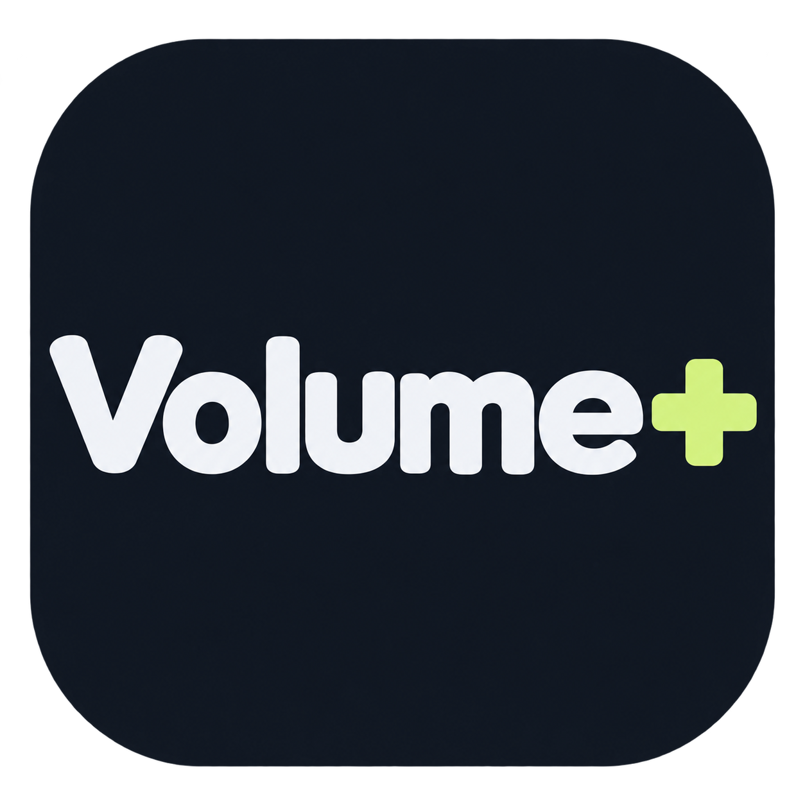

# Volume +



A C# / WPF desktop app for Windows that adjusts playback gain through a separately installed [Equalizer APO](https://sourceforge.net/projects/equalizerapo/).

- Standard gain slider: **100-200%**.
- **Custom percentage**: enter a positive whole number, including values above 200%. Values at or above 200% require acknowledgement of the distortion warning.
- Seven interface languages: **English, Türkçe, Español, Français, Português, Bahasa Indonesia, Deutsch**. The app starts in English and saves your language choice.
- Normal app exit restores the additional Volume + gain to **100% / 0 dB**. Existing EQ settings and Windows master volume are preserved.
- Volume + was developed with AI assistance.
  
## Run

**[Download Volume + for Windows x64](https://github.com/ygzmert0707/VolumePlus/releases/latest)**. In the release's Assets, choose `VolumePlus-v1.2.4-win-x64.zip`; the `Source code` archives are for building the app yourself.

Extract the complete Windows x64 release ZIP into a folder, then open `VolumePlus.exe`. Keep the included license and notice files with the app. The self-contained build includes .NET; no separate .NET installation is needed. On first launch, review and accept the terms for the bundled Microsoft runtime components to continue.

For amplification, first install Equalizer APO from its official project. Volume + does not install the audio driver.

1. In Equalizer APO's **Device Selector** (called **Configurator** in older releases), select your speakers or headphones.
2. Restart Windows if requested. Keep **Audio enhancements** enabled for that output in Windows sound settings.
3. Open Volume +, refresh the device list, select that output, and apply the gain. Start at 100% and increase gradually.

If a custom Equalizer APO installation denies access to its configuration folder, Volume + offers an optional administrator relaunch.

## How gain works

100% adds 0 dB, 150% adds approximately 3.52 dB, and 200% adds approximately 6.02 dB. The percentage describes signal amplitude: 200% doubles amplitude; it does not mean twice the perceived loudness. The calculation is `20 × log10(percent / 100)`. Custom values below 100% reduce the signal.

Volume + preserves existing EQ settings and backs up the main configuration before adding its managed block. **Remove Volume + from audio config** removes that block. Closing the app normally disables its extra gain, and the next session starts at 100%. Forced termination, a crash, or power loss may prevent the exit reset; reopen the app and reset the gain if that happens.

Amplification can cause clipping and distortion; Volume + does not provide a limiter or clipping protection. Reduce the gain if sound distorts. Applications that bypass Equalizer APO, including ASIO and some WASAPI exclusive paths, are not boosted.

Volume + retains the earlier `SesPlus` preference folder and Equalizer APO integration identifiers, including `sesplus.txt`, to reuse existing settings and safely manage configurations created by previous versions. The source project folders also keep their existing names.

## Privacy

Volume + has no app analytics, account service, or automatic data upload. Preferences and runtime-license acceptance are stored locally, and optional download links open your browser. Windows / .NET crash reporting may send diagnostic data to Microsoft according to your Windows settings; see [Microsoft's privacy statement](https://privacy.microsoft.com/privacystatement) and [docs/PRIVACY.md](docs/PRIVACY.md).

## Build and check

On Windows, install the [.NET 10 SDK](https://dotnet.microsoft.com/download/dotnet/10.0), then run from the repository root:

```powershell
dotnet run --project tests/SesPlus.Tests -c Release -p:UseSharedCompilation=false
powershell -ExecutionPolicy Bypass -File .\scripts\build.ps1
```

The default build pins the bundled runtime to the version recorded in the third-party license inventory and verifies the legal files before packaging. It creates `dist/VolumePlus-v1.2.4/`, `dist/VolumePlus-v1.2.4-win-x64.zip`, `dist/VolumePlus-v1.2.4-source.zip`, and a `.sha256` checksum for each ZIP. The source ZIP excludes build output, local caches, and user preferences. See [docs/ICON.md](docs/ICON.md) for the app icon artwork and Windows icon packaging script.

GitHub Actions checks builds and tests on Windows. The **Package release** workflow is run manually and uploads ZIPs as workflow artifacts; it does not create or publish a GitHub Release.

## License and distribution

Volume + source and original app icon assets are licensed under the **MIT License** in [LICENSE](LICENSE). Third-party components retain their own terms.

The self-contained Windows build includes .NET runtime components, WPF / Windows Desktop components, Windows Forms integration components, and Windows SDK-related runtime libraries. Their licenses, copyright notices, provenance, and applicable Windows redistribution terms are preserved in [third-party](third-party/). See [NOTICE.md](NOTICE.md) and [docs/LICENSING.md](docs/LICENSING.md) for the inventory and publishing procedure. Distributors and end users must agree to the applicable Microsoft terms for the bundled proprietary components; the app provides those terms on first launch.

Equalizer APO is separately installed and is **not bundled** in Volume + source or release packages. It is licensed under **GPL-2.0-or-later**. Volume + edits its text configuration files; it does not include or link to Equalizer APO code or DLLs. Equalizer APO and Microsoft do not sponsor or endorse Volume +.

For GitHub, publish the source repository with all legal files, and attach the **complete release ZIP**, rather than the EXE alone. Preserve third-party license and notice files when redistributing or modifying the package. If you later bundle Equalizer APO code or binaries, review and satisfy its GPL requirements before distribution.

## Primary references

- [Equalizer APO setup and troubleshooting](https://sourceforge.net/p/equalizerapo/wiki/Documentation/)
- [Equalizer APO configuration reference](https://sourceforge.net/p/equalizerapo/wiki/Configuration%20reference/)
- [Equalizer APO source and GPL license declaration](https://sourceforge.net/p/equalizerapo/code/ci/main/tree/DeviceAPOInfo.cpp)
- [.NET Windows licensing information](https://github.com/dotnet/core/blob/main/license-information-windows.md)
- [Windows endpoint volume API: scalar range 0.0-1.0](https://learn.microsoft.com/en-us/windows/win32/api/endpointvolume/nf-endpointvolume-iaudioendpointvolume-setmastervolumelevelscalar)

---

# Volume + - Türkçe

Windows'ta ses kazancını ayarlayan C# / WPF uygulaması. Gerçek yükseltme için ayrı kurulan [Equalizer APO](https://sourceforge.net/projects/equalizerapo/) kullanır.

- Standart kaydırıcı **%100-200** aralığındadır.
- **Özel yüzde** ile 0'dan büyük bir tam sayı girebilirsiniz. %200 ve üstünde ses bozulması uyarısını onaylamanız gerekir.
- **English, Türkçe, Español, Français, Português, Bahasa Indonesia, Deutsch** dil seçenekleri vardır. İlk açılış İngilizcedir; dil tercihiniz kaydedilir.
- Uygulamayı normal biçimde kapattığınızda Volume +'ın ek kazancı **%100 / 0 dB** olur. Mevcut EQ ve Windows ses düzeyi korunur.
- Volume +, yapay zekâ (AI) desteğiyle geliştirilmiştir.
  
## Çalıştırma

**[Windows x64 için Volume + indir](https://github.com/ygzmert0707/VolumePlus/releases/latest)**. Sürümün Assets bölümünden `VolumePlus-v1.2.4-win-x64.zip` dosyasını seçin; `Source code` arşivleri uygulamayı kendiniz derlemek içindir.

Windows x64 sürümünün ZIP dosyasını bir klasöre tamamen çıkarıp `VolumePlus.exe` dosyasını açın. Paketteki lisans ve bildirim dosyalarını uygulamanın yanında tutun. Hazır sürüm .NET içerir; ayrıca .NET kurmanız gerekmez. İlk açılışta paketteki Microsoft çalışma zamanı bileşenlerinin koşullarını okuyup kabul ederek devam edin.

Önce Equalizer APO'yu resmi projesinden yükleyin. Kurulumda **Device Selector** (eski sürümlerde **Configurator**) içinden çıkış cihazınızı seçin; istenirse Windows'u yeniden başlatın. Windows ses ayarlarında bu çıkış için **Ses geliştirmeleri** açık kalsın. Volume +'ı açın, cihaz listesini yenileyin, aynı çıkışı seçin ve %100'den başlayarak artırın. Yapılandırma klasörüne erişim reddedilirse uygulama isteğe bağlı yönetici olarak yeniden açılabilir.

%100 ek kazanç uygulamaz; %200 sinyal genliğini iki katına çıkarır, algılanan ses yüksekliğini iki katına çıkaracağı anlamına gelmez. Ses bozulursa kazancı azaltın; uygulama kırpılma koruması sağlamaz. Normal kapatmadan sonra yeni oturum %100'den başlar. Zorla kapatma, çökme veya elektrik kesintisi kapanış sıfırlamasını engelleyebilir; böyle bir durumda uygulamayı yeniden açıp kazancı sıfırlayın.

Volume +, önceki sürümlerin ayarlarını ve Equalizer APO yapılandırmasını güvenle kullanabilmek için `SesPlus` tercih klasörünü ve `sesplus.txt` dahil mevcut entegrasyon adlarını korur. Kaynak proje klasörlerinin adları da aynı kalır.

Volume + uygulama analitiği toplamaz ve otomatik veri yüklemez. Tercihler ve çalışma zamanı lisans onayı cihazda saklanır; isteğe bağlı indirme bağlantıları tarayıcınızı açar. Windows / .NET hata raporlaması Windows ayarlarınıza göre Microsoft'a tanılama verisi gönderebilir. Ayrıntılar: [Gizlilik açıklaması](docs/PRIVACY.md), [Microsoft gizlilik bildirimi](https://privacy.microsoft.com/privacystatement).

## Derleme ve lisanslar

Derleme komutları yukarıdaki **Build and check** bölümündedir. Volume +'ın özgün kaynak kodu [MIT lisansı](LICENSE) ile paylaşılır. .NET ve diğer üçüncü taraf bileşenlerin kendi lisansları [third-party](third-party/) klasöründedir; MIT lisansımız bunların yerine geçmez. Paket içindeki ilgili Microsoft bileşenleri için hem dağıtıcı hem son kullanıcı uygulanabilir Microsoft koşullarını kabul etmelidir.

Equalizer APO pakete dahil değildir; kullanıcı ayrıca kurar. Kendi lisansı **GPL-2.0-or-later**'dır. Volume + yalnızca metin yapılandırma dosyalarıyla etkileşir. GitHub'a kaynakları lisans dosyalarıyla birlikte koyun; hazır uygulamayı **tüm dosyaları içeren ZIP** olarak paylaşın. Ayrıntılar: [NOTICE.md](NOTICE.md), [docs/LICENSING.md](docs/LICENSING.md).
